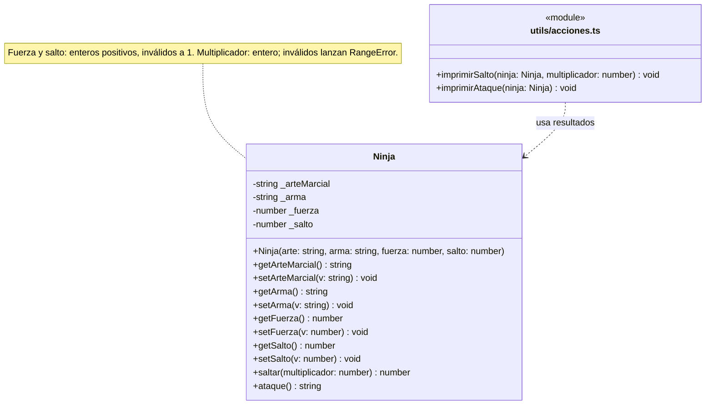

7.​ Crear una clase Ninja con las variables privadas arteMarcial, arma, fuerza (entero) y salto (entero).

- Crear setters y getters manualmente.
- Crear una función saltar() que reciba un parámetro multiplicador (entero); imprimir por consola salto x parámetro.
- Crear la función ataque() que imprima por consola el arma que usa el ninja y el arte marcial.
- Crear dos instancias de Ninja, asignar distintos valores para cada uno de los atributos e invocar las funciones saltar() y ataque().

---

## Cierre AUD-TS-04: consigna y decisión vigente

Se conserva el enunciado original de arriba y la arquitectura ya implementada:

| Aspecto | Consigna literal | Implementación basada en SRP |
| --- | --- | --- |
| Salto | `saltar()` imprime salto por multiplicador | `saltar(multiplicador)` devuelve el número; `imprimirSalto` lo imprime |
| Ataque | `ataque()` imprime arma y arte marcial | `ataque()` devuelve el texto; `imprimirAtaque` lo imprime |
| Presentación | Impresión desde los métodos del objeto | Funciones exportadas de `utils/acciones.ts`; no existe una clase `Acciones` |

Esta adaptación está justificada en el análisis histórico: separa el cálculo y
los datos del objeto de la salida de consola. Los resultados pedidos se imprimen
al invocar las funciones auxiliares desde `index_01EJ07.ts`. Se comprueban tanto
los valores devueltos como la ausencia de impresión en `Ninja` y la impresión de
una sola línea por cada función auxiliar. No hace falta introducir otro patrón.

No se afirma que los métodos de `Ninja` impriman literalmente. Si la cátedra exige
esa responsabilidad dentro de `saltar()` y `ataque()`, la alternativa sería mover
allí la impresión y revisar sus contratos y las funciones auxiliares para evitar
salidas duplicadas. Eso abandonaría la decisión SRP actual y requiere una decisión
académica explícita; no se realiza unilateralmente en este cierre. Imprimir desde
una clase no constituye por sí solo una infracción universal de SRP: aquí se
conserva la separación concreta elegida para el ejercicio.

### Revisión de datos y validaciones

- Los cuatro atributos siguen privados y tienen getters y setters manuales.
- El constructor ya delegaba fuerza y salto en sus setters. Se conserva la regla
  previa de usar `1` para valores no positivos, y se completa el control de enteros:
  fracciones, `NaN` e infinitos también se normalizan a `1` en ambas vías.
- `saltar()` exige un multiplicador entero y lanza `RangeError` si recibe una
  fracción, `NaN` o un infinito. Se admiten cero y enteros negativos: la consigna
  no exige que el multiplicador sea positivo. No se redondea ni se cambia el valor
  recibido silenciosamente.
- Los textos de arte marcial y arma se conservan tal como se asignan; no se añaden
  restricciones no pedidas. La fuerza no interviene en la fórmula de salto ni en
  el texto de ataque porque el enunciado no lo solicita.
- Las invocaciones del principal ya eran correctas. Los saltos siguen siendo
  `10`, `9` y `2`; el tercer ninja conserva fuerza y salto normalizados a `1`.

### UML: originales preservados y vista actualizada

`01EJ07.dio` y `01EJ07.png` se conservan sin cambios como material histórico.
La vista superior muestra `saltar(): void` sin multiplicador y `ataque(): void`;
la inferior ya muestra los retornos actuales, pero dibuja `Acciones` como clase.
También faltan constructor/getters/setters, la visibilidad privada no está clara
en la vista superior y la dependencia apunta a una operación en vez de a `Ninja`.
El fragmento de código del diagrama tampoco muestra el control de enteros nuevo.

La siguiente vista corresponde a la implementación actual. La caja con
estereotipo `module` representa el archivo de funciones, no una clase instanciable:



### Verificación reproducible

Desde la raíz del repositorio, con las dependencias existentes:

```bash
npm run typecheck
npm run build
npm run ejercicio -- ejercicios/01EJ07/index_01EJ07.ts
npm run ejercicio -- ejercicios/01EJ07/verificar_ninja.ts
```

`verificar_ninja.ts` usa aserciones de Node sin dependencias nuevas. Comprueba
getters y setters, ocho casos numéricos mediante constructor y setters, instancias
independientes, multiplicadores positivos/cero/negativos, rechazo de cinco valores
no enteros o no finitos, textos exactos y responsabilidades de impresión. Las
pruebas también se pueden ejecutar como
`node dist/ejercicios/01EJ07/verificar_ninja.js` tras compilar.

Las notas que siguen son el historial del análisis y sus correcciones, no tareas
pendientes de la implementación actual.

---

## Análisis histórico

## Qué está pidiendo el ejercicio (lo esencial)

Vas a modelar una clase `Ninja` con **4 atributos privados:**

- `arteMarcial` (string)

- `arma` (string)

- `fuerza` (entero)

- `salto` (entero)

Y después:

1. **Setters y getters manuales**

&nbsp; Acá “manual” suele significar **métodos tipo `getX()` / `setX()`**, no properties `get x()` / `set x()`.

2. `saltar(multiplicador: entero)`

&nbsp; Tiene que **imprimir** `salto \* multiplicador`.

3. `ataque()`

&nbsp; Tiene que **imprimir** el arma y el arte marcial.

4. En `main`: crear **2 ninjas**, asignar valores distintos y ejecutar `saltar()` y `ataque()` en ambos.

---

## ¿Patrones de diseño?

Para este ejercicio, **no aplica ningún patrón GoF** de manera natural. Es un ejercicio de encapsulación + métodos.

---

## ¿SOLID?

Acá sí hay un tema: **SRP (Single Responsibility)**.

- Si seguimos el enunciado literal, `saltar()` y `ataque()` **imprimen** por consola → la clase mezcla “modelo del dominio” con “salida por consola”.

- En SRP puro, lo ideal sería que esos métodos **devuelvan un string** (o un número) y que el `console.log` quede en `main` (o en otra clase).

📌 PERO: como el enunciado dice explícitamente “imprimir por consola”, probablemente la cátedra quiere verlo así, aunque no sea SRP perfecto.

### Entonces necesito que me digas cómo seguimos

¿Querés que lo hagamos:

1. **Literal al enunciado** (los métodos imprimen), o

2. **SRP estricto** (los métodos devuelven y `main` imprime), y en un comentario aclaramos que el enunciado pedía imprimir?

---

# Resumen

Tranquilo, estás **muy cerca**, pero te mezclaste en 3 puntos. Te lo dejo **directo y cortito** para destrabar.

---

## 1) `Ninja.ts`: sacá esos `export {}` pegados y el `;` final raro

Tu archivo debería terminar **solo** con la clase. Nada de:

```ts
}; export {};
```

✅ Dejalo así al final:

```ts
}
```

(El `export {}` se usa en otros ejercicios para “forzar módulo”, pero acá ya estás exportando la clase, no hace falta.)

---

## 2) `acciones.ts`: NO lo hagas clase, hacelo funciones sueltas

Vos dijiste que `acciones.ts` iba a tener funciones sueltas. Entonces no uses `class Acciones`.

✅ `acciones.ts` debería ser así:

```ts
import Ninja from "./Ninja";

export function imprimirSalto(ninja: Ninja, multiplicador: number): void {
  console.log(ninja.saltar(multiplicador));
}

export function imprimirAtaque(ninja: Ninja): void {
  console.log(ninja.ataque());
}
```

Listo. SRP OK: Ninja no imprime, acciones sí.

---

## 3) `index_01EJ07.ts`: estás llamando mal a `imprimirSalto`

Esto que pusiste:

```ts
(imprimirSalto, mininja1);
```

no llama nada.

✅ Tenés que **importar las funciones** y llamarlas bien:

```ts
import Ninja from "./Ninja";
import { imprimirSalto, imprimirAtaque } from "./acciones";

function main(): void {
  const ninja1 = new Ninja("Karate", "Nunchaku", 9, 5);
  const ninja2 = new Ninja("Ninjutsu", "Katana", 7, 3);

  imprimirSalto(ninja1, 2);
  imprimirAtaque(ninja1);

  imprimirSalto(ninja2, 3);
  imprimirAtaque(ninja2);
}

main();
```

---

### Resumen del “arreglo”

- `Ninja.ts` = solo la clase (sin `export {}` al final).
- `acciones.ts` = **funciones sueltas exportadas** (no clase).
- `index` = `import { imprimirSalto, imprimirAtaque }` y llamadas con paréntesis.

Aplicá esos 3 cambios y me pegás **solo el error que te quede** (si queda alguno).
