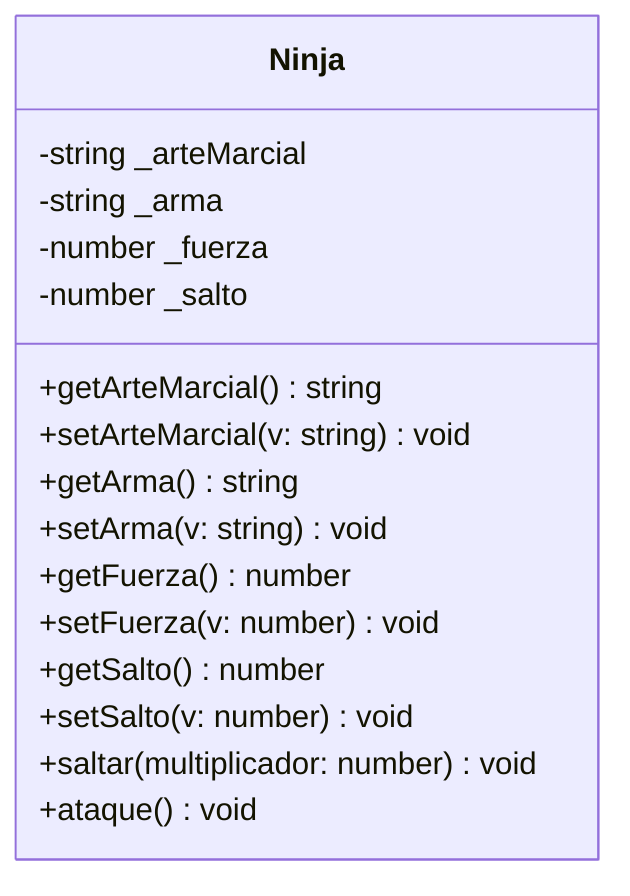

7.​ Crear una clase Ninja con las variables privadas arteMarcial, arma, fuerza (entero) y salto (entero).

- Crear setters y getters manualmente.
- Crear una función saltar() que reciba un parámetro multiplicador (entero); imprimir por consola salto x parámetro.
- Crear la función ataque() que imprima por consola el arma que usa el ninja y el arte marcial.
- Crear dos instancias de Ninja, asignar distintos valores para cada uno de los atributos e invocar las funciones saltar() y ataque().

---

## Resolución académica

Referencia: [EJ07 en C#](https://github.com/gastonjavierricchiardi/ejercicios-csharp-utn-2026/tree/main/src/Guia01/EJ07), especialmente `Ninja.cs` y `Program.cs`.

Se conserva una sola clase, `Ninja`, con cuatro atributos privados y getters y
setters manuales. No se declara un constructor: se utiliza el constructor vacío
implícito. Los textos se inicializan en `""` y los números en `0`, sin cambiar la
configuración estricta de TypeScript. Los valores numéricos del ejemplo son
enteros; en TypeScript se representan con `number`.

Los setters asignan directamente los valores recibidos, sin normalizaciones,
validaciones adicionales ni excepciones. `saltar(multiplicador): void` imprime
`salto * multiplicador`; `ataque(): void` imprime el arma y el arte marcial.
La fuerza conserva su getter y setter, pero no participa en esos métodos porque
la consigna no lo pide.

El principal crea exactamente dos instancias con `new Ninja()`, carga los cuatro
atributos mediante setters y llama a `saltar()` y `ataque()` en cada objeto,
siguiendo los mismos valores de la resolución C#.

## Comentario sobre SRP

La clase reúne lógica de negocio e impresión en pantalla. Aunque se podría
separar la presentación para aplicar SRP, aquí se conserva la impresión directa
porque la consigna académica la solicita expresamente. Por ese motivo se retiran
las funciones auxiliares y las pruebas de la adaptación anterior, sin introducir
otras clases ni patrones.

## UML

Los archivos históricos `01EJ07.dio` y `01EJ07.png` se conservan sin cambios.
La vista superior ya usa métodos `void`, aunque omite el multiplicador de
`saltar()`. La vista inferior, con retornos de valores y una caja `Acciones`,
corresponde a la adaptación SRP anterior y ya no representa esta resolución.
La clase actual se resume así:

## Revisión de los ejemplos

Por lectura del código, el primer salto corresponde a `3 * 2 = 6` y el segundo a
`5 * 3 = 15`. Los ataques muestran `Katana / Karate` y `Nunchaku / Jiu-Jitsu`,
respectivamente, con una línea vacía entre ambas instancias, como en C#.
Estos son resultados esperados: el programa no se ejecutó para esta revisión.
