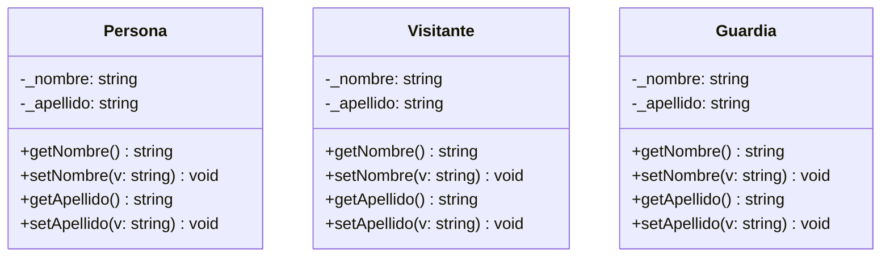

# 01EJ08 — Persona, Visitante y Guardia

## Enunciado

8. Crear una clase `Persona` que tenga los atributos privados:
   - nombre
   - apellido

   Con sus setters y getters.

   - Crear una clase llamada `Visitante` con los mismos atributos, con sus setters y getters.
   - Crear una clase `Guardia` con los mismos atributos, con sus setters y getters.
   - Crear una instancia de cada una de las clases y asignarle valores.
   - Mostrar por pantalla los valores.

## Diagrama de clases UML

Las tres clases son independientes. La repetición de atributos y métodos es intencional: la herencia se introduce en el ejercicio 01EJ09. Se omiten los constructores vacíos implícitos.
