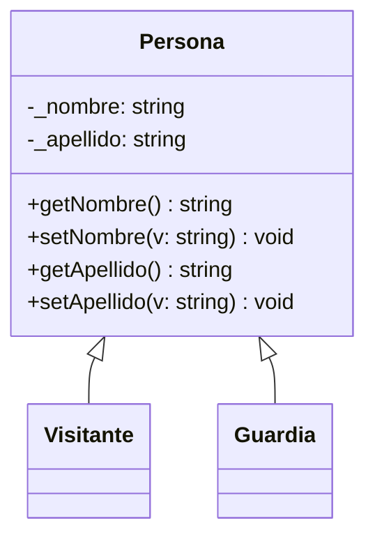

# 01EJ09 — Herencia

## Enunciado

9. Crear una clase Persona que tenga los atributos privados nombre y apellido, con sus setters y getters.

- Crear una clase llamada Visitante que extienda de Persona.
- Crear una clase Guardia que extienda de Persona.
- Crear una instancia de cada una de las clases y asignarle valores.
- Mostrar por pantalla los valores; estudiar las ventajas del uso de la herencia.

## Diagrama de clases UML según la cátedra

## Análisis académico

- **Persona** es una clase concreta y se puede instanciar.
- **Visitante** y **Guardia** heredan de **Persona** mediante `extends`.
- Los atributos privados `_nombre` y `_apellido`, junto con sus getters y setters, se definen una sola vez en **Persona**. Las clases hijas utilizan los métodos públicos heredados.
- Los constructores vacíos son implícitos; no es necesario representarlos en el UML.
- La flecha con triángulo vacío apunta a la clase padre (**Persona**).
- **A diferencia del EJ08**, este ejercicio introduce herencia para evitar repetir los atributos y métodos comunes.

> El diagrama representa únicamente la implementación TypeScript auditada. La actualización de los archivos `.dio` y `.png` queda pendiente.
