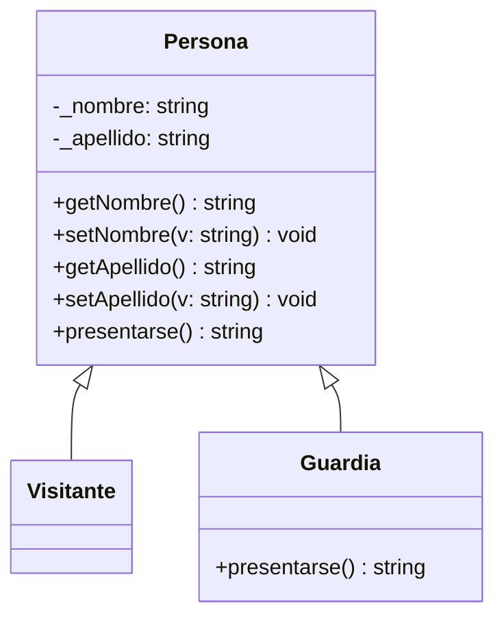

# 01EJ10 — Herencia y sobreescritura de métodos

## Enunciado

10. Continuando con el ejemplo anterior, realizar las siguientes modificaciones:

- Agregar en `Persona` el método `presentarse()` que devuelva nombre y apellido de la persona.
- Crear una instancia de cada una de las clases y asignarle valores.
- Mostrar por pantalla los valores.
- Sobreescribir el método `presentarse()` en la clase `Guardia` de modo tal que devuelva el siguiente mensaje: «Hola, mi nombre es <nombre y apellido> y soy el guardia.», donde `<nombre y apellido>` debe ser reemplazado por el nombre y apellido del guardia.
- Mostrar por pantalla el resultado de invocar el método `presentarse()` y advertir que la implementación en la clase `Guardia` tiene precedencia sobre la de su padre.

---

## Diagrama de clases UML — Según la implementación TypeScript



## Análisis académico

1. **Herencia:** `Guardia` y `Visitante` extienden a `Persona` y heredan sus getters, setters y el método `presentarse()`.
2. **Sobreescritura:** `Guardia` redefine `presentarse()` para devolver un saludo propio. Al invocar ese método sobre un objeto `Guardia`, se utiliza la implementación de la clase hija.
3. **Reutilización:** `Visitante` no redefine `presentarse()`; utiliza directamente la implementación heredada de `Persona`. No es necesario declarar constructores explícitos para este ejercicio.

### Salida esperada según el código (sin ejecutar)

```text
Gastón Ricchiardi
Desirée Candelaria
Hola, mi nombre es Carlos Gómez y soy el guardia.
```

**Nota:** Los archivos históricos `.dio` y `.png` quedan pendientes de actualización. Este Mermaid documenta el código TypeScript auditado del EJ10.
