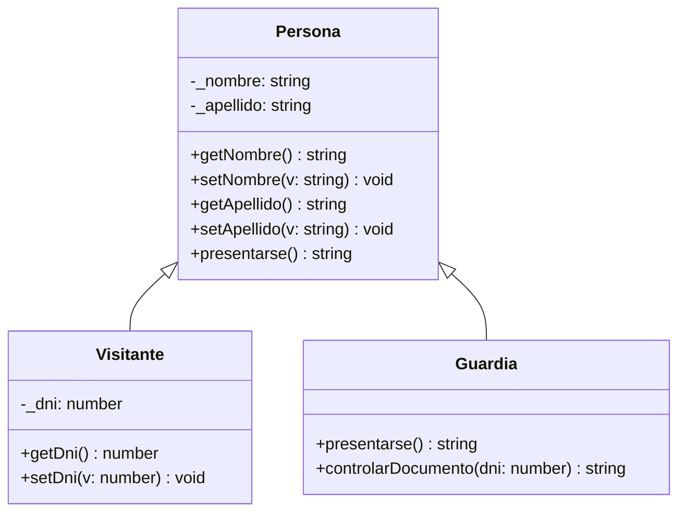

# 01EJ11 — Herencia, sobreescritura y control de documentos

## Enunciado

11. Continuando con el ejemplo anterior, realizar las siguientes modificaciones:

- Agregar en `Visitante` el atributo privado `dni` (numérico) con sus setters y getters correspondientes.
- Agregar en `Guardia` el método público `controlarDocumento()` que reciba como parámetro el `dni` de la persona y devuelva el mensaje `"Adelante persona con dni <dni>"`, donde `<dni>` es el valor recibido por parámetro.
- Crear una instancia de cada una de las clases y asignarle valores.
- Mostrar por pantalla los valores.

---

## Diagrama de clases UML (Mermaid)



## Análisis académico

- `Persona` reúne los atributos comunes `nombre` y `apellido`, con getters y setters manuales. Su método `presentarse()` devuelve el nombre completo.
- `Visitante` hereda de `Persona` e incorpora solamente `dni` y sus correspondientes getters/setters. Hereda `presentarse()` sin sobrescribirlo.
- `Guardia` hereda de `Persona`, sobrescribe `presentarse()` e incorpora `controlarDocumento(dni: number): string`.
- El método `controlarDocumento()` **recibe un número**, no un objeto `Visitante`, tal como solicita el enunciado.
- Las tres clases utilizan el constructor vacío implícito. El diagrama no lo representa porque no está declarado explícitamente.

## Salida esperada

Según las asignaciones del archivo `index_01EJ11.ts`:

```text
Gastón Ricchiardi
Desirée Candelaria
Hola, mi nombre es Carlos Gómez y soy el guardia.
DNI: 12345678
Adelante persona con dni 12345678
```

> Salida deducida de la lectura del código; el programa no fue ejecutado.

**Nota:** Se conservan los diagramas históricos `.dio` y `.png` hasta que puedan actualizarse manualmente.
