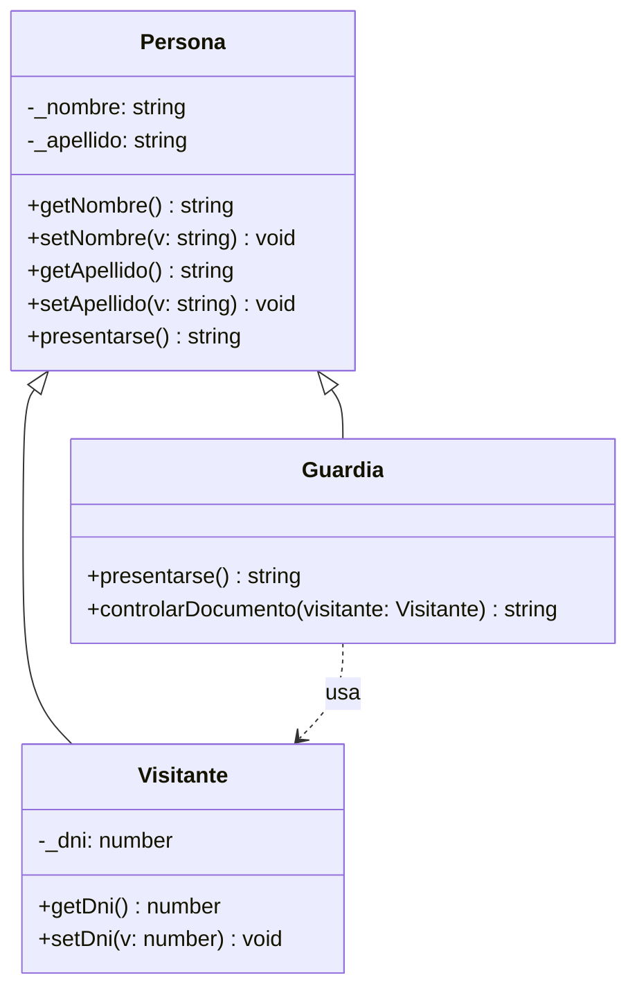

# EJ12 — Control de documento de un visitante

## Enunciado

12. Continuando con el ejemplo anterior, realizar las siguientes modificaciones:

- Modificar la clase Guardia para que el método público controlarDocumento() devuelva el mensaje “Adelante <nombre completo del visitante> con dni <dni>” reemplazando respectivamente con el nombre completo del visitante y su dni.
- Crear una instancia de cada una de las clases y asignarle valores.
- Mostrar por pantalla los valores.
- Analizar si es posible pasar un único parámetro al método controlarDocumento() y estudiar las ventas y desventajas que tendría asociado.

> El enunciado de TypeScript dice «ventas y desventajas»; se entiende «ventajas y desventajas», como aparece en la versión C#.

## Diagrama de clases UML — Mermaid



## Análisis académico

- `Persona` contiene los atributos privados `_nombre` y `_apellido`, con getters y setters manuales, y el método `presentarse()`.
- `Visitante` y `Guardia` heredan de `Persona`. `Visitante` agrega el atributo privado `_dni` con sus getter y setter.
- `Guardia` sobrescribe `presentarse()` y declara `controlarDocumento(visitante: Visitante): string`.
- El método recibe **un único parámetro**, el objeto `Visitante`, y accede a su nombre completo mediante `presentarse()` y a su DNI mediante `getDni()`.
- **Ventaja:** se pasan juntos los datos del visitante y no es necesario suministrar nombre completo y DNI por separado.
- **Desventaja:** `Guardia` depende de la clase `Visitante`, como muestra la relación de dependencia del diagrama.
- A diferencia del EJ11, aquí el método no recibe solamente un número, sino un objeto del que obtiene ambos datos.

## Salida esperada

Según el código TypeScript revisado, **sin ejecutar el programa**:

```text
Gastón Ricchiardi
Desirée Candelaria
Hola, mi nombre es Carlos Gómez y soy el guardia.
DNI: 12345678
Adelante Desirée Candelaria con dni 12345678
```

## Estado de revisión

- Código TypeScript: revisado y aprobado respecto del enunciado del EJ12.
- `npm run typecheck`: Codex informó resultado correcto (código 0).
- Ejecución del programa: no realizada.
- Archivos `.dio` y `.png`: actualización postergada.
