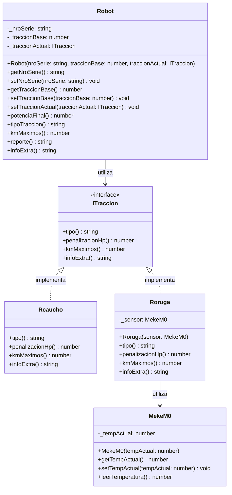

# EJ13 — Robot explorador KT-2020

## Enunciado de la cátedra

13. El laboratorio Kokumo Technologies está desarrollando el prototipo de un robot explorador cuyo sistema de tracción puede ser personalizado para que se adapte mejor al terreno.

### El robot, llamado KT-2020, tiene las siguientes características:

- Número de serie: KT-2020-P
- Potencia de tracción base (PTB): 10 hp
- Tracción: cualquiera de las dos opciones desarrolladas.

**Los sistemas de tracción disponibles son:**

- **Rueda de caucho:** ideal para entornos urbanos, su uso le resta 1 hp al PTB y permite el rodado de hasta 100 km; cuando se gasta, debe reemplazarse.
- **Oruga:** para todo tipo de terreno, le permite avanzar hasta 400 km antes de requerir reemplazo y resta 3 hp al PTB. Incorpora sensores Meke-M0 que le permiten conocer la temperatura.

### Analizar, diseñar, diagramar las relaciones e implementar el código.

Crear instancias de cada una de las clases y asignarle al robot los distintos sistemas de tracción, procurando mostrar por pantalla los siguientes datos entre las distintas asignaciones:

1. Número de serie
2. potencia de tracción final
3. tipo de tracción,
4. cuanto puede avanzar
5. y datos sobre cualquier característica adicional que posea.

---

## Diagrama de clases UML — Implementación TypeScript

## Análisis académico

- **Abstracción:** `ITraccion` define las operaciones que el robot necesita, independientemente de la tracción concreta.
- **Polimorfismo:** `Robot` trabaja con `ITraccion` y admite tanto `Rcaucho` como `Roruga`.
- **Intercambio de componentes:** `setTraccionActual()` permite cambiar la tracción sin cambiar de robot.
- **Sensor:** `Roruga` recibe un objeto `MekeM0` mediante su constructor para obtener la temperatura. En el UML se representa una asociación: el sensor es proporcionado desde fuera de la oruga.
- **Alcance:** se informan los kilómetros máximos antes del reemplazo. No se implementa una simulación del desgaste progresivo porque el enunciado no la solicita.

## Valores esperados según el código

| Sistema de tracción | Potencia base | Penalización | Potencia final | Avance máximo | Información adicional |
|---|---:|---:|---:|---:|---|
| Rueda de caucho | 10 hp | 1 hp | 9 hp | 100 km | Sin dato adicional |
| Oruga | 10 hp | 3 hp | 7 hp | 400 km | Temperatura: 32 °C |

**Nota:** estos resultados son deducidos de la implementación revisada y del valor inicial del sensor. No se ejecutó el programa. Los archivos `.dio` y `.png` se conservan para su actualización posterior.
