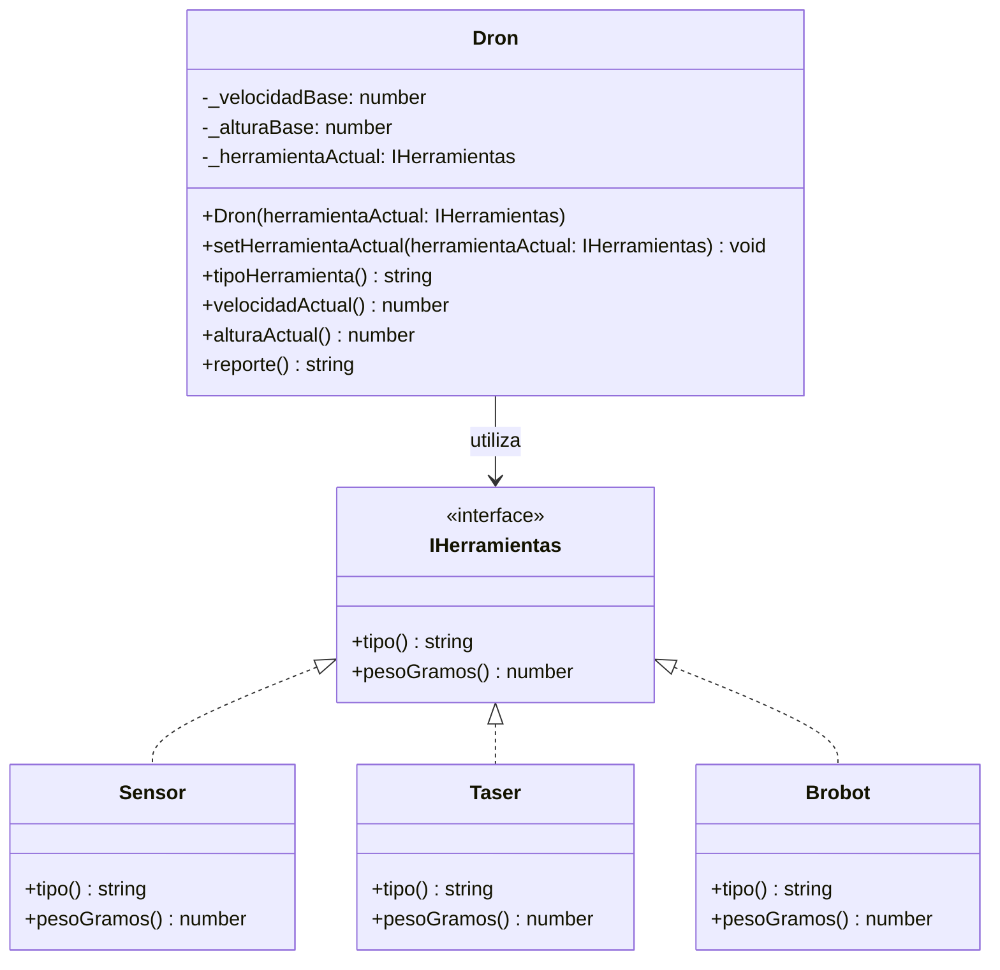

# EJ14 — Dron y herramientas intercambiables

## Enunciado original

14. Una empresa de seguridad que se dedica a la vigilancia mediante el empleo de drones, ha desarrollado un sistema de montaje que permitirá que los drones puedan cargar, además de la cámara de vigilancia, una herramienta accionable a distancia.

**Actualmente el sistema de anclaje admite:**

- Sensor infrarrojo: pesa 250 gramos
- Taser: pesa 300 gramos
- Brazo robótico: pesa 500 gramos

El dron puede soportar hasta 200 gramos sin sufrir penalizaciones de velocidad (5 mts/s) ni altura (100 mts); luego, por cada 50 gramos extras, el dron reduce su velocidad en 2% y la altura en 5%.

Analizar, diseñar, diagramar las relaciones e implementar el código.

Crear instancias de cada una de las clases y asignarle al dron las distintas herramientas, procurando mostrar por pantalla los siguientes datos entre las distintas asignaciones:

velocidad, altura y tipo de herramienta que lleva.

---

## Diagrama de clases UML — implementación TypeScript

## Análisis académico

- **Dron** mantiene los valores base de velocidad (5 m/s) y altura (100 m), y utiliza una herramienta que puede reemplazarse mediante `setHerramientaActual()`.
- **IHerramientas** define las operaciones `tipo()` y `pesoGramos()`. `Sensor`, `Taser` y `Brobot` implementan esa interfaz.
- **Relación UML:** `Dron` se asocia con `IHerramientas`; las tres clases concretas tienen relaciones de realización con la interfaz. La herramienta se entrega en el constructor y puede intercambiarse después.
- **Regla de cálculo:** hasta 200 g, no hay penalización. Por cada tramo de 50 g adicionales se descuenta un 2 % de la velocidad base y un 5 % de la altura base. Los tres pesos del enunciado son múltiplos exactos de 50 g por encima del límite.
- La consigna solicita mostrar el tipo de herramienta, la velocidad y la altura después de cada cambio. Eso se realiza mediante `reporte()`.

## Resultados esperados — sin ejecutar el programa

| Herramienta | Peso | Tramos adicionales | Velocidad final | Altura final |
|---|---:|---:|---:|---:|
| Sensor infrarrojo | 250 g | 1 | 4,9 m/s | 95 m |
| Taser | 300 g | 2 | 4,8 m/s | 90 m |
| Brazo robótico | 500 g | 6 | 4,4 m/s | 70 m |

> **Nota:** Los diagramas históricos `01EJ14.dio` y `01EJ14.png` se conservan sin modificaciones. Este Markdown documenta la implementación TypeScript revisada.
