# EJ16 — Diagrama de clases

El diagrama representa el código TypeScript actual. Los constructores se muestran con el nombre de la clase y sin tipo de retorno. `+` indica público, `-` privado y `#` protegido; Mermaid muestra en cursiva las operaciones abstractas y subraya los miembros estáticos. Los getters de los elementos ofrecen únicamente lectura.

```mermaid
classDiagram
    direction TB

    class Item {
        <<abstract>>
        -string _descripcion
        -number _alto
        -number _ancho
        -number _profundidad
        -number _numeroIdentificador
        #Item(descripcion: string, alto: number, ancho: number, profundidad: number, numeroIdentificador: number)
        +getDescripcion() string
        +getAlto() number
        +getAncho() number
        +getProfundidad() number
        +getNumeroIdentificador() number
    }

    class Bicicleta {
        -number _rodado
        -boolean _esElectrica
        -number _cantidadCambios
        -boolean _esPlegable
        +Bicicleta(descripcion: string, alto: number, ancho: number, profundidad: number, numeroIdentificador: number, rodado: number, esElectrica: boolean, cantidadCambios: number, esPlegable: boolean)
        +getRodado() number
        +getEsElectrica() boolean
        +getCantidadCambios() number
        +getEsPlegable() boolean
    }

    class CajaPequena {
        +CajaPequena(descripcion: string, alto: number, ancho: number, profundidad: number, numeroIdentificador: number)
    }

    class Comoda {
        -number _superficie
        -number _cantidadCajones
        +Comoda(descripcion: string, alto: number, ancho: number, profundidad: number, numeroIdentificador: number, superficie: number, cantidadCajones: number)
        +getSuperficie() number
        +getCantidadCajones() number
    }

    class Heladera {
        -number _voltaje
        -boolean _poseeFreezer
        +Heladera(descripcion: string, alto: number, ancho: number, profundidad: number, numeroIdentificador: number, voltaje: number, poseeFreezer: boolean)
        +getVoltaje() number
        +getPoseeFreezer() boolean
    }

    class Lavarropas {
        -number _voltaje
        -number _carga
        -number _revolucionesCentrifugado
        +Lavarropas(descripcion: string, alto: number, ancho: number, profundidad: number, numeroIdentificador: number, voltaje: number, carga: number, revolucionesCentrifugado: number)
        +getVoltaje() number
        +getCarga() number
        +getRevolucionesCentrifugado() number
    }

    class Televisor {
        -number _voltaje
        -TipoPantalla _tipoPantalla
        -boolean _esInteligente
        +Televisor(descripcion: string, alto: number, ancho: number, profundidad: number, numeroIdentificador: number, voltaje: number, tipoPantalla: TipoPantalla, esInteligente: boolean)
        +getVoltaje() number
        +getTipoPantalla() TipoPantalla
        +getEsInteligente() boolean
    }

    class TipoPantalla {
        <<enumeration>>
        LED = 0
        LCD = 1
    }

    class Vehiculo {
        <<abstract>>
        -Item[] _items
        #Vehiculo()
        +cargar(item: Item) void*
        +listarItems() Item[]
        #tieneCapacidad(capacidadMaxima: number) boolean
        #agregarElemento(item: Item) void
    }

    class Auto {
        -number _capacidadMaxima$
        +Auto()
        +cargar(item: Item) void
    }

    class Camioneta {
        -number _capacidadMaxima$
        +Camioneta()
        +cargar(item: Item) void
    }

    Item <|-- Bicicleta
    Item <|-- CajaPequena
    Item <|-- Comoda
    Item <|-- Heladera
    Item <|-- Lavarropas
    Item <|-- Televisor
    Vehiculo <|-- Auto
    Vehiculo <|-- Camioneta

    Vehiculo "0..*" o-- "0..*" Item : _items
    Televisor --> TipoPantalla : _tipoPantalla
    Auto ..> Televisor : admite
    Auto ..> Bicicleta : admite si es plegable
    Auto ..> CajaPequena : admite
    Camioneta ..> Comoda : admite
    Camioneta ..> Heladera : admite
    Camioneta ..> Lavarropas : admite

    note for Vehiculo "listarItems() devuelve una copia del arreglo.\nLos Item existen independientemente del vehiculo.\nEl arreglo permite referencias repetidas."
    note for Auto "_capacidadMaxima: static readonly = 5.\nSolo carga si hay capacidad y el tipo esta permitido.\nBicicleta requiere getEsPlegable() igual a true."
    note for Camioneta "_capacidadMaxima: static readonly = 10.\nSolo carga si hay capacidad y el tipo esta permitido."
```

